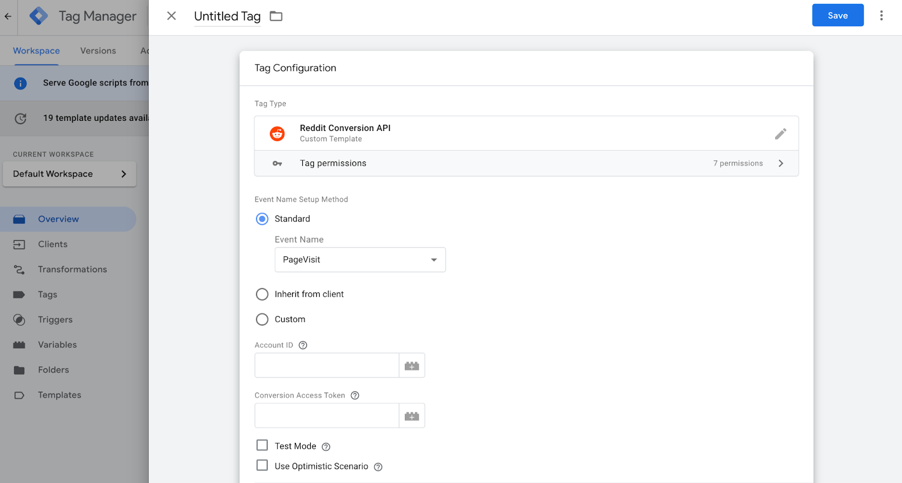

# Reddit Conversions API Tag for Google Tag Manager Server Container

The Reddit Conversion API Tag for server Google Tag Manager provides insights into Reddit marketing efforts, allowing strategies to be optimized accordingly.

## Tag Description

The Reddit Conversion API Tag allows conversion data to be sent from the Google Tag Manager to Reddit servers. With the tag, you can edit and send fields such as Common Event Data Override, Server Event Data Override, and User Data by specifying the parameters you want to exclude or override.

## Tag settings

**Event Name Setup Method** - select from a list of standard events, add a custom event, or choose to Inherit an event name from a client. When Inherit from a client is selected, the Reddit CAPI tag will try to map events automatically into standard events or use a custom name if it's impossible to map into a standard event.

**Pixel ID** - ID of the pixel (data source) on your Reddit Ads account. It can be found in the Reddit Events Manager.

**Conversion Access Token** - a secure key that lets send conversion event data.

**Action Source** - the channel where the conversion happened: Website, App, Physical Store, or Other. Used for [omnichannel attribution](https://business.reddithelp.com/s/article/omni-attribution) and source-level conversion metrics in reporting. Defaults to Website.

**Test ID** - ID for using the [Reddit Event Testing Tool](https://ads.reddit.com/events-manager/testing).

**Use Optimistic Scenario** - the tag will trigger gtmOnSuccess() immediately without waiting for an API response. While this feature improves sGTM's response time, it also means that even if the tag fails to fire correctly, it will still report a success status.

### Common Event Data Override

**Automap Common Event Data** - when enabled, the tag automatically maps common event parameters from the event data. Any value manually entered in the fields below overrides the auto-mapped value. Enabled by default.

- **Event At** - Unix epoch in milliseconds timestamp when the conversion event occurred.
- **Click ID** - the Reddit-generated ID (`rdt_cid`) associated with a single ad click.
- **Event Source URL** - URL where the conversion event occurred. Only available when Action Source is Website.

### Override Server Event

**Automap Server Event Data** - when enabled, the tag automatically maps server event parameters from the event data. Any value manually entered in the table below overrides the auto-mapped value. Enabled by default.

- Conversion ID
- Currency
- Item Count
- Products
- Value

### Override User Data

**Automap User Data** - when enabled, the tag automatically maps user data parameters from the event data. Any value manually entered in the table below overrides the auto-mapped value. Enabled by default.

- Email
- Phone Number
- External ID
- IP Address
- User Agent
- Screen Dimensions
- UUID (_rdt_uuid first-party cookie)
- IDFA (Identifier for Advertisers — iOS)
- AAID / GAID (Android Advertising ID)
- Opt out / Data Processing Options

## Useful resouces
- [How to set up the Reddit CAPI tag](https://stape.io/blog/reddit-conversion-api-tag-for-server-google-tag-manager#how-to-set-up-reddit-capi-tag)

## Open Source
The **Reddit Tag for GTM Server Side** is developed and maintained by [Stape Team](https://stape.io/) under the Apache 2.0 license.

### GTM Gallery Status
🟢 [Listed](https://tagmanager.google.com/gallery/#/owners/stape-io/templates/reddit-tag)
